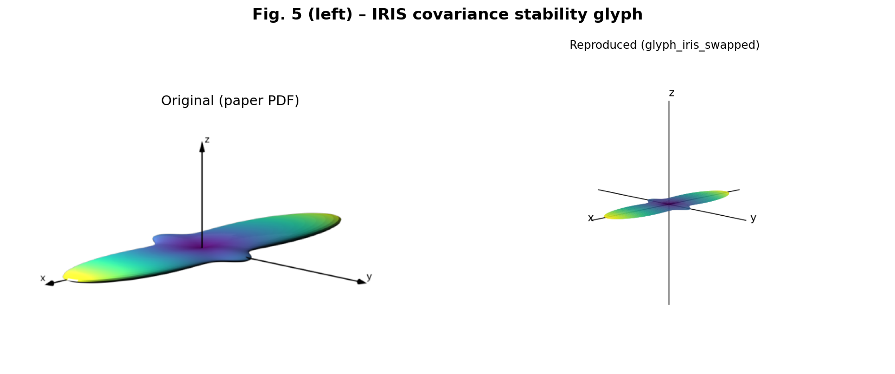
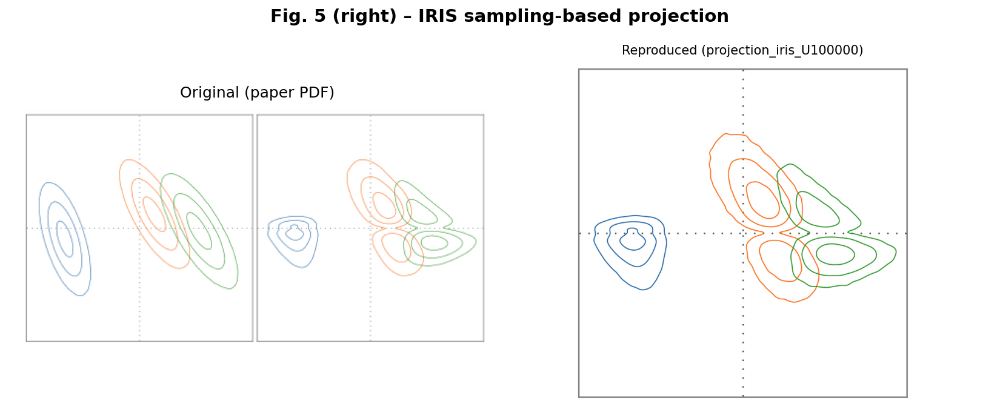
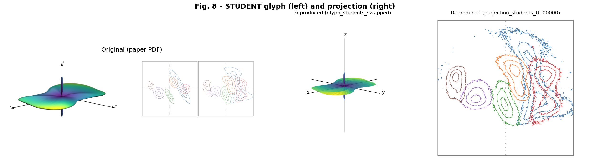
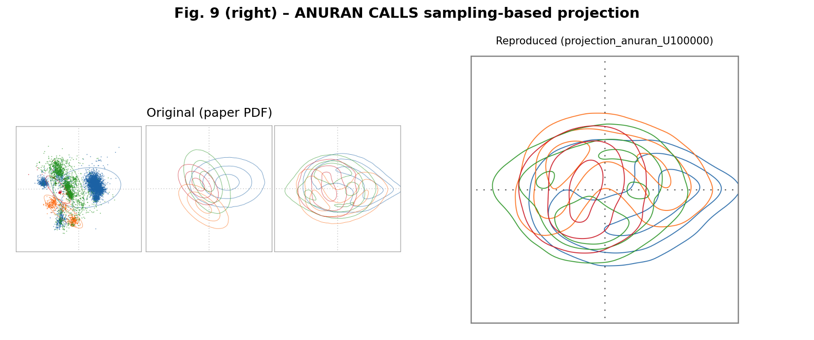

# WK9AS2: Reproducing "Uncertainty-Aware PCA Revisited" (IEEE VIS 2025)

CPS 5745: Week 9, Assignment 2, Part 3

- **Paper:** L. Friesecke, C. Braune, C. Rössl, H. Theisel, *Uncertainty-Aware PCA Revisited*, IEEE VIS 2025. [PDF](https://vc.cs.uni-magdeburg.de/assets/publications/2026/Friesecke_2026_VIS.pdf)
- **Authors' code:** https://github.com/lfriesecke/uncertainty-aware-pca-revisited/
- **Report:** [WK9AS2.pdf](WK9AS2.pdf) | **Mini-presentation:** [WK9AS2_presentation.pdf](WK9AS2_presentation.pdf)

## Reproduced figures

| Paper figure | Comparison |
|---|---|
| Fig. 5 left: IRIS covariance stability glyph |  |
| Fig. 5 right: IRIS sampling-based projection |  |
| Fig. 8: STUDENT glyph and projection |  |
| Fig. 9 right: ANURAN CALLS projection |  |

## How to run (Windows / PowerShell)

```powershell
git clone https://github.com/lfriesecke/uncertainty-aware-pca-revisited.git repo
cd repo; python -m venv venv_uapcar; cd ..
repo\venv_uapcar\Scripts\python -m pip install -r requirements_py310.txt pymupdf
$env:MPLCONFIGDIR = "$PWD\.mplcache"
repo\venv_uapcar\Scripts\python scripts\reproduce_glyphs.py                 # Fig. 5 / 8 glyphs (~1 min)
repo\venv_uapcar\Scripts\python scripts\reproduce_projections.py all 100000 # Fig. 5 / 8 / 9 projections
repo\venv_uapcar\Scripts\python scripts\crop_original_figures.py            # crop originals from the paper PDF
repo\venv_uapcar\Scripts\python scripts\make_comparisons.py 100000          # side-by-side images
```

## Dependencies, errors, and changes

| | Authors | Me |
|---|---|---|
| Python | 3.13.5 | 3.10.10 |
| numpy | 2.3.1 | **2.2.6** |
| matplotlib, contourpy, etc. | pinned | same versions |

1. **Error:** `pip install -r requirements.txt` failed with `No matching distribution found for numpy==2.3.1` because numpy 2.3 requires Python 3.11 or newer. **Fix:** [requirements_py310.txt](requirements_py310.txt) pins numpy 2.2.6. I did not have to change any code.
2. **Runtime:** The paper uses U = 1,000,000 realizations. On my laptop, U = 10,000 took about 75 s for IRIS, so 1M would take about 2 h per dataset. **Change:** I used U = 100,000 and kept all other parameters from the authors' examples (bins = 250, R = 0.2, axis limits, scale matrices, colors, seed).
3. **No glyph renderer:** The repo only exports `.off` meshes. **Change:** [reproduce_glyphs.py](scripts/reproduce_glyphs.py) draws them with matplotlib (viridis colormap).
4. **Glyph axis order:** The released `glyph.py` has a commented-out `idx = [2, 1, 0]  # TODO: ask if wanted`. Without it, the first eigenvector maps to x instead of z as the paper describes. Applying the reversal (the same as swapping x and z of the mesh) reproduces the paper's glyphs. I saved both versions.

Logs: [logs_glyphs.txt](logs_glyphs.txt), [logs_proj_10k.txt](logs_proj_10k.txt), [logs_proj_100k.txt](logs_proj_100k.txt), [pip_attempt1.log](pip_attempt1.log).

